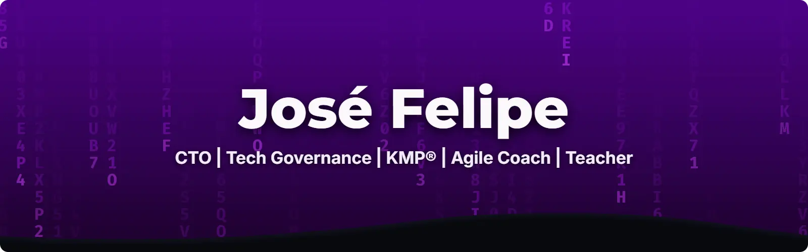

<div align="center">
  
</div>

<br/>

<div align="center">
  
  <br/><br/>
  <a href="https://zespek.com.br/"></a>
</div>

<br/>

_ ./resumo_profissional.sh" />

<div align="center">
  
</div>

<details>
<summary>ver em texto</summary>

```ini
zespek@server:~$ cat ./resumo_profissional.ini
[ Conectando Código de Alta Performance, Cloud, Segurança e Gestão Estratégica ]

[Resumo_Profissional]
  - "Sócio e CTO na Mestres da Web, à frente da governança técnica e ainda hands-on no código."
  - "Foco em arquitetura, liderança técnica, engenharia de alta performance e entrega contínua."
  - "Verdadeira paixão por codar e arquitetar soluções tecnológicas complexas."
  - "Especialista em Full Stack & Mobile: do absoluto zero até o deploy em produção."

[Lideranca_Ensino]
  - "Agile Coach: comando times de alta performance com Scrum e Kanban (KMP®)."
  - "Teacher: professor de Engenharia de Software na Universidade de Mogi das Cruzes."
```

</details>

---

_ ./dominio_em_engenharia_e_deploy.sh" />

<div align="center">
  
</div>

<details>
<summary>ver em texto</summary>

```ini
zespek@server:~$ cat ./detalhes_engenharia.ini
[ O coração do meu trabalho é estruturar sistemas escaláveis e orientados a performance: ]

[Frontend_Mobile]
  - "Interfaces interativas e ultrarrápidas com React, Next.js, Astro e TypeScript."
  - "Experiências 3D interativas na web com Three.js."
  - "Apps mobile multiplataforma com React Native e Expo."
  - "Apps desktop leves com Tauri."

[Backend_Arquitetura]
  - "Lógicas de negócio complexas, seguras e eficientes."
  - "Node.js com Express e NestJS, e ORMs modernos como Prisma."
  - "PostgreSQL, MongoDB e Redis para suprir alto volume de requisições."
  - "Integração com ERPs, gateways de pagamento e APIs de mensageria."

[DevOps_Cloud]
  - "Deploy contínuo com pipelines de CI/CD no GitHub Actions."
  - "Servidores Linux com Nginx, PM2 e Docker: proxy reverso, HTTPS e conteinerização."
  - "Ecossistema Cloud: AWS, Azure, GCP, Oracle Cloud, DigitalOcean, Vercel e Netlify."
  - "Cloudflare na borda: DNS, proxy e proteção."

[Areas_em_que_ja_desenvolvi]
  - "Saúde e bem-estar, indústria, agro e logística, varejo e food service."
  - "Turismo, eventos e lazer, serviços sob demanda, educação e conteúdo."
  - "Imobiliário e hospedagem, creators e redes sociais, segurança e ocorrências."
  - "Dispositivos e bluetooth, IA aplicada, pagamentos e fiscal, sites e marketing."
```

</details>

---

_ ./seguranca_em_producao.sh" />

<div align="center">
  
</div>

<details>
<summary>ver em texto</summary>

```ini
zespek@server:~$ cat ./seguranca.log
[ Acho a falha no sistema antes que outra pessoa ache, e fecho junto com o time. ]

[Como_trabalho]
  - "Sistema que já está em produção: API, servidor, banco e o caminho entre eles."
  - "Cada achado vem com a correção, o teste e o monitoramento ligado para a próxima vez."

[Aplicacao]
  - "Segurança de API e controle de acesso (escalada de papel, IDOR)."
  - "Injeção e entrada de dados, anti-abuso e limite de requisições."
  - "Vazamento de credenciais: segredo fora do código e fora do log."

[Infraestrutura]
  - "Hardening de servidor: SSH só por chave, firewall e fail2ban."
  - "Isolamento de infraestrutura, monitoramento e auditoria com alertas."

[Vulnerabilidades_e_Incidentes]
  - "Gestão de vulnerabilidades: varredura e plano de atualização de Node e pacotes."
  - "Resposta a incidente: logs, linha do tempo, correção e reteste."

[Para_quem]
  - "Empresas com sistema no ar, agências que entregam software para clientes"
  - "e times que não têm ninguém dedicado à segurança."
```

</details>

---

_ ./lideranca_tecnica_e_agil.sh" />

<div align="center">
  
</div>

<details>
<summary>ver em texto</summary>

```ini
zespek@server:~$ cat ./lideranca_tecnica.ini
[ A tecnologia ganha poder quando alinhada a uma gestão eficiente: ]

[CTO_Tech_Governance]
  - "Liderança executiva e governança técnica, alinhando arquitetura e escala."
  - "Painel próprio de operação: saúde, custo e segurança de dezenas de projetos."

[Agile_Coach_KMP]
  - "Implementação ágil (Scrum/Kanban) na veia dos times, quebrando silos."
  - "Kanban Management Professional (KMP®): fluxo, limites de WIP e entrega previsível."

[Teacher]
  - "Docente no ensino superior em Engenharia de Software, na Universidade de Mogi das Cruzes."
```

</details>

---

_ ./formacao_academica.sh" />

<div align="center">
  
</div>

<details>
<summary>ver em texto</summary>

```ini
zespek@server:~$ cat ./formacao.ini
[ Graduação, pós e certificação, com a validação de cada uma logo abaixo: ]

[Graduacao]
  - "Bacharel em Ciência da Computação, UNG Universidade Guarulhos (2023)."

[Pos_Graduacao]
  - "MBA em Gestão de Projetos em TI, Faculdade Anhanguera (2024)."
  - "MBA em Cybersecurity e Cybercrimes, Faculdade Anhanguera (2025)."
  - "Pós em Ciência de Dados e Inteligência Artificial, Faculdade Anhanguera (2026)."
  - "MBA em Marketing Digital e Analytics, Faculdade Anhanguera (em conclusão, 2026)."

[Certificacao]
  - "Kanban Management Professional (KMP®), Kanban University (2025)."
```

</details>

<div align="center">
  <a href="https://www.certeduc.com:45344/getdocumento/04302037000800/1374026891486/0c4e221a2102e848a7bc5a5729875d264511662b829ae4660f2045b2cc3413cd30187212fe7fc1dcc87aceec42c1429bb656ca0d4f2b3f4e62fbb74cb34bdc36/pdf"></a>
  <a href="https://kroton.platosedu.io/docs/validar/29829818fc93c479db5f2439759ac8243bf1517806623295ac4f3ee885121925fb6585"></a>
  <br/>
  <a href="https://kroton.platosedu.io/docs/validar/29829876741ba37af6e3f874dd3e6b9b04f3571a30192d248658a107b5aa37cb7a6e7b"></a>
  <a href="https://kroton.platosedu.io/docs/validar/298298bd31e82cb978b1662220b480e13782df81abd6107f480dccbe3f0f34fe3ad0e1"></a>
  <br/>
  <a href="https://kanban.university/kuapps/sites/default/files/certificates/certificate-52dcd210112409d7a695ce60c45a8957314c95029be08677be2ed4751085580d.pdf"></a>
</div>

---

_ ./arsenal_tecnologico.sh" />

<div align="center">
  
</div>

<details>
<summary>ver em texto</summary>

```ini
zespek@server:~$ cat ./arsenal.ini
[ API / servidor / banco / código ]

[Com_o_que_eu_trabalho]
  - "Revisão de código e de permissões rota a rota."
  - "Varredura de dependências e de falhas publicadas."
  - "Leitura de logs e de tráfego."
  - "Monitoramento com alerta, automação de servidor e de deploy."
  - "Scripts próprios para o que se repete."
```

</details>

<div align="center">
  
  
  
  
  
  <br/>
  
  
  
  
  
  
  <br/>
  
  
  
  
  
  <br/>
  
  
  
  
  
  <br/>
  
  
  
  
  
  <br/>
  
  
  
  
  
  <br/>
  
  
  
  <br/><br/>
  
  
  
  
  
</div>

---

_ ./github_stats.sh" />

<div align="center">
  
  <br/><br/>
  <picture>
    <source media="(prefers-color-scheme: dark)" srcset="https://raw.githubusercontent.com/Zespek/Zespek/output/cobra-escura.svg" />
    <source media="(prefers-color-scheme: light)" srcset="https://raw.githubusercontent.com/Zespek/Zespek/output/cobra-clara.svg" />
    
  </picture>
</div>

---

_ ./conecte_se.sh" />

<div align="center">
  <a href="https://zespek.com.br/"></a>
  <a href="https://www.linkedin.com/in/josé-felipe-de-frança"></a>
  <a href="https://github.com/Zespek"></a>
  <a href="https://www.instagram.com/ze._.felipe/"></a>
</div>

<br/>

<div align="center">
  
</div>

<br/>

<p align="center">
  <a href="https://github.com/Zespek"></a>
</p>
