<div align="center">
  
</div>

<br/>

<div align="center">
  
</div>

<br/>

_ ./resumo_profissional.sh" />

```ini
zespek@server:~$ cat ./resumo_profissional.ini
[ Conectando Código de Alta Performance, Cloud, Segurança e Gestão Estratégica ]

[Resumo_Profissional]
  - "Sócio e CTO na Mestres da Web, atuando hands-on como Senior Software Engineer e Tech Lead."
  - "Foco em arquitetura, liderança técnica, engenharia de alta performance e entrega contínua."
  - "Verdadeira paixão por codar e arquitetar soluções tecnológicas complexas."
  - "Especialista em Full Stack & Mobile: do absoluto zero até o deploy em produção."

[Lideranca_Ensino]
  - "Comando times de alta performance através de metodologias ágeis."
  - "Atuo como Professor de Engenharia de Software para formar a nova geração de Devs."
```

---

_ ./dominio_em_engenharia_e_deploy.sh" />

```ini
zespek@server:~$ cat ./detalhes_engenharia.ini
[ O coração do meu trabalho é estruturar sistemas escaláveis e orientados a performance: ]

[Frontend_Mobile]
  - "Interfaces interativas e ultrarrápidas com React, Next.js e TypeScript."
  - "Apps multiplataforma com React Native / Expo e Kotlin Multiplatform (KMP)."
  - "Apps desktop leves com Tauri."

[Backend_Arquitetura]
  - "Lógicas de negócio complexas, seguras e eficientes."
  - "Node.js com Express e NestJS, e ORMs modernos como Prisma."
  - "PostgreSQL, MongoDB e Redis para suprir alto volume de requisições."
  - "Integração com ERPs, gateways de pagamento e APIs de mensageria."

[DevOps_Cloud]
  - "Deploy contínuo com pipelines de CI/CD no GitHub Actions."
  - "Servidores Linux com Nginx, PM2 e Docker: proxy reverso, HTTPS e conteinerização."
  - "Ecossistema Cloud: AWS, Azure, GCP, Oracle Cloud, DigitalOcean, Vercel e Netlify."
  - "Cloudflare na borda: DNS, proxy e proteção."
```

---

_ ./seguranca_em_producao.sh" />

```ini
zespek@server:~$ cat ./seguranca.log
[ Segurança não é etapa final: entra no código, no servidor e na rotina. ]

[Aplicacao]
  - "Auditoria de permissões e de acesso a dados (escalada de papel, IDOR)."
  - "Validação de entrada, limite de requisições e travas contra robôs."
  - "Log sem dado sensível: senha e dado pessoal não vão para o log."

[Servidores]
  - "Linux endurecido: SSH só por chave, firewall e fail2ban."
  - "Sensores próprios de login, reboot, disco e backup, com alerta por e-mail."

[Dependencias]
  - "Varredura de vulnerabilidades e plano de atualização de Node e pacotes."

[Resposta_a_Incidentes]
  - "Investigação por logs e linha do tempo, com correção e reteste."
```

---

_ ./lideranca_tecnica_e_agil.sh" />

```ini
zespek@server:~$ cat ./lideranca_tecnica.ini
[ A tecnologia ganha poder quando alinhada a uma gestão eficiente: ]

[CTO_Tech_Governance]
  - "Liderança executiva e governança técnica, alinhando arquitetura e escala."
  - "Painel próprio de operação: saúde, custo e segurança de dezenas de projetos."

[Agile_Coach_Scrum]
  - "Implementação ágil (Scrum/Kanban) na veia dos times, quebrando silos."

[Business_Education]
  - "Docente no ensino superior em Engenharia de Software."

[Data_Science_IA]
  - "Pós-graduado em Data Science & Inteligência Artificial, com foco em NLP."
  - "IA aplicada à engenharia: agentes de código com revisão e reteste humano."
```

---

_ ./arsenal_tecnologico.sh" />

<div align="center">
  
  
  
  
  
  
  <br/>
  
  
  
  
  
  
  <br/>
  
  
  
  
  
  
  <br/>
  
  
  
  
  
  
  <br/>
  
  
  
  
  
  <br/>
  
  
  
  
  
  <br/><br/>
  
  
  
  
</div>

---

_ ./github_stats.sh" />

<div align="center">
  
  <br/><br/>
  <picture>
    <source media="(prefers-color-scheme: dark)" srcset="https://raw.githubusercontent.com/Zespek/Zespek/output/cobra-escura.svg" />
    <source media="(prefers-color-scheme: light)" srcset="https://raw.githubusercontent.com/Zespek/Zespek/output/cobra-clara.svg" />
    
  </picture>
</div>

---

_ ./conecte_se.sh" />

<div align="center">
  <a href="https://www.linkedin.com/in/josé-felipe-de-frança"></a>
  <a href="https://github.com/Zespek"></a>
  <a href="https://www.instagram.com/ze._felipe"></a>
  <a href="mailto:joezika2016@gmail.com"></a>
</div>

<br/>

<div align="center">
  
</div>

<br/>

<p align="center">
  <a href="https://github.com/Zespek"></a>
</p>
